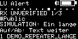
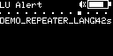

# LU-Alert für MeshCore

**Unabhängiges Community-Projekt für MeshCore in Luxemburg und der Region, keine offizielle LU-Alert-App.** Das [offizielle Warn- und Informationssystem LU-Alert](https://lu-alert.lu/de.html) wird von den öffentlichen Behörden betrieben. MeshCore-Textnachrichten können verspätet eintreffen oder verloren gehen. Keine Gewähr für Zustellung, Vollständigkeit oder Aktualität; kein Ersatz für offizielle Warnungen oder Notfallkommunikation.

**Wio RC8: zehn Kanalmenüs für Inbox, Live RX und Quick TX.** #public · #test · #lu-alert · #trafic · #luxembourg · #hammradio · #bot · #emergency · #saarland · #trier. Die manuelle RX-Auswahl und die Sendemenüs verwenden dieselbe Liste; die Inbox kann auch alle Kanäle anzeigen. Die Namen sind Menüvorlagen für die eigene Tracker-Konfiguration, keine exportierten Kanalprofile oder Schlüssel.

[Kanalauswahl im Browser ausprobieren](https://lu-alert.nosrv.eu/simulator/?demo=channels) · [Wio-Downloads](https://lu-alert.nosrv.eu/downloads/?board=wio) · [Kanäle und Bedienung](docs/CHANNELS.md) · [Quick-TX-Vorlagen](docs/COMMANDS.md).

**Laufschrift und vierstellige PIN bleiben erhalten.** Lange Nachrichten, Absender und Repeater-Namen laufen nach einer Lesepause nach links; kurze Texte stehen still. Die PIN wird im Menü „Bildschirmsperre“ erstellt, geändert oder entfernt.

**Heltec bleibt dev4 · Vorschau.** Die bestehende PRG-Version mit acht Kanalmenüs, PIN und bisheriger Darstellung bleibt unverändert. Die neue Wio-Kanalauswahl ist keine Heltec-Freigabe. Kein Gerät wurde geflasht.

[Website](https://lu-alert.nosrv.eu) · [GitHub](https://github.com/levelstation/lu-alert) · [Testbericht](TEST-REPORT.md) · [Heltec-Roadmap](docs/ROADMAP.md)

## Laufschrift auf dem Wio

Überlange Textfelder werden vollständig lesbar: Der Anfang steht zunächst 1,2 Sekunden, dann läuft der Text nach links. Empfangsalter, Signalpegel und Symbole daneben behalten ihren Platz. Neue Nachrichten und eine andere Auswahl starten den Text wieder von vorn. Empfang und GPS laufen weiter; für die Anzeige entstehen keine zusätzlichen Funkpakete.

[Nachrichten und lange Repeater-Namen ausprobieren](https://lu-alert.nosrv.eu/simulator/?demo=scroll) · [Firmware, Mac-Simulator und Quellpaket](https://lu-alert.nosrv.eu/downloads/?board=wio) · [Prüfsummen](docs/downloads/text-scroll/SHA256SUMS).





Die neue Laufschrift wurde in Software und Browser-Simulation geprüft. Der physische Test dieser Funktion steht noch aus. Heltec behält die bestehende dev4-Vorschau; es wurde kein Gerät geflasht.

## Vierstellige Bildschirm-PIN

Menü → **Bildschirmsperre** → **PIN erstellen**. Vier Ziffern wählen und wiederholen; zum Ändern oder Entfernen den bisherigen Code eingeben. Auf dem Wio werden Joystick und ENTER benutzt, auf dem Heltec kurze und längere PRG-Tastendrücke. Ein Neustart erhält die gespeicherte Sperre.

[PIN-Downloads und Mac-Simulatoren](docs/downloads/pin/) · [Bedienung](docs/SCREEN-PIN.md) · [Softwareprüfungen](docs/SCREEN-PIN-TEST-REPORT.json). Wio aktuell: **v0.2.0-lu-alert-rc8**, [Laufschrift-Downloads](https://lu-alert.nosrv.eu/downloads/?board=wio). Heltec: **dev4 · Vorschau**, R2/R8; physische Tests der neuen PIN-Funktion stehen aus. Vorherige Downloads bleiben erhalten.

## Technik und Grenzen

Ziel ist der ursprüngliche Seeed Studio Wio Tracker L1 Pro OLED: 128 × 64 Pixel, ein Bit und ein gemeinsamer 1024-Byte-Framebuffer. Firmware und Mac-App verwenden dieselben Menü-, Quick-TX-, RX-, Sperr- und Displayklassen. Die App ersetzt Hardware durch ausdrücklich simulierte lokale Adapter. Bestehende MeshCore-/BLE-/Funkprotokolle bleiben erhalten.

Die Menünamen sind keine gespeicherten Kanalprofile. Ein Eintrag wird zur Laufzeit anhand des eindeutigen vorhandenen Namens gesucht und vor dem Senden einschließlich Schlüssel erneut geprüft. Die Anwendung erstellt, ändert und löscht keine Kanäle oder Schlüssel. Fehlt der passende Name, erscheint CHANNEL NOT CONFIGURED. Bereits bestehender Empfang und Companion-Funktionen bleiben erhalten.

Quick TX: Kanal → Vorlage → exakter Text → Enter. DEVICE ACCEPTED bedeutet lokale Annahme, kein Empfangs-ACK. Keine automatischen Wiederholungen. Die letzten acht RX-Texte bleiben in begrenztem RAM, Auf/Ab scrollt, Links/Rechts blättert. Gruppen-Absender werden nicht allein anhand eines Namenspräfixes als verifizierter Bot ausgegeben.

Drei entprellte MENU-Drücke innerhalb von 1200 ms sperren oder entsperren. Einzeldrücke werden bis zum Ende des Zeitfensters zurückgehalten. Zwei MENU-Drücke innerhalb von 1200 ms schalten Sound genau einmal an oder aus, ohne Menüaktion. Der Doppelklick wartet das vollständige Dreifachklick-Fenster ab; ein dritter Druck sperrt/entsperrt ohne Tonänderung. SOUND ON/OFF bestätigt den Zustand. Während der Sperre wird auch der Sound-Doppelklick ignoriert. Während der Sperre sind Navigation und neue Quick-TX-Aufträge blockiert; RX, GPS und Hintergrundfunktionen laufen weiter. Normaler Reset erhält Einstellungen und die bisherigen Dateischlüssel.

Radio und Live Radio / GPS zeigen `Noise est: … dBm`. Das ist der bereits vom MeshCore-Treiber geschätzte Grundrauschpegel, keine neue Messung durch das Menü. Die Anzeige liest nur `getNoiseFloor()`; sie startet weder Scan noch Kalibrierung und ändert keine Funkparameter. Vor einer gültigen Schätzung erscheint `not ready`. Der vorhandene Treiber mittelt 64 ruhige Empfangsproben und begrenzt die Schätzung nach unten auf -120 dBm. Der Wert kann nach einer Kalibrierung unverändert bleiben und ist kein laufender Spektrumanalysator. RSSI/SNR des letzten Pakets sind davon getrennte Werte.

GPS-Kurs ist ein Bewegungskurs aus frischen gültigen RMC-Daten, kein Magnetkompass. Ohne Fix, im Stillstand und nach acht Sekunden werden keine aktuellen Richtungen vorgetäuscht. UTC und Anzeigezeit bleiben getrennt; Europe/Luxembourg ist Standard.

Die aktuelle Wio-Ausgabe ist eine Software-Vorschau; der physische Test der neuen Kanalauswahl steht noch aus. Es wurde kein Gerät geflasht. Bei einem Dateisystem-Mountfehler wird nicht automatisch formatiert.

## Build und Start

Apple Silicon, macOS 14+, Apple Command Line Tools. Keine zusätzliche GUI-Bibliothek nötig; bestehende AppKit-App und vendorte Grafikquellen.

```sh
sh simulator/build.sh
./meshis-simulator
./meshis-simulator --self-test build/screenshots
SIM_SANITIZE=1 sh simulator/build.sh
./build/meshis-simulator-asan --self-test build/asan
```

Pfeile = Joystick, Enter = Joystick-Druck, Escape = MENU. 2× Escape/MENU in 1,2 s schaltet Sound an/aus; 3× sperrt/entsperrt. Der Doppelklick wird nach Ablauf des 1200-ms-Fensters ausgeführt. Cmd+R setzt nur die Simulation zurück. Der Simulator öffnet keine Geräteschnittstelle.

Firmware: Python-Umgebung mit PlatformIO 6.1.19 und pyelftools, dann `sh tools/build_firmware.sh`. Das Skript kompiliert ausschließlich und validiert BIN, UF2, echte Anwendungs-DFU, CRC und Speicherbereiche. Kein Upload-Schritt. Grundlage: MeshCore-Commit 75b04ef06def54b348400cb1b138afb6749ffd4f, S140 7.3.0 / FWID 0x0123. Abhängigkeiten mit Versionsbereichen und Compiler-Zeitstempel verhindern eine allgemeine Zusage bitidentischer Neubauten.

UF2-Family-ID 0xADA52840 ist keine Board-ID. Die individuelle INFO_UF2-Board-ID und installierte SoftDevice-Version wurden nicht ausgelesen. E-Ink und Pro 1W sind nicht unterstützt. Der individuelle OLED-Controller ist nicht anhand einer Panelkennzeichnung nachgewiesen.

[Offizielle Hardwaredokumentation](https://wiki.seeedstudio.com/wio_tracker_l1_node/) · MeshCore MIT, siehe LICENSE und vendor/meshcore/LICENSE · Adafruit GFX BSD, siehe simulator/vendor/adafruit-gfx/license.txt. Unabhängiges Community-Projekt.

## Websimulation

[Im Browser ausprobieren](https://lu-alert.nosrv.eu/simulator/). Die Browser-Version kompiliert denselben C++-Simulator nach WebAssembly: FirmwareScreens, QuickTx, KeyLock, MenuActions, LockRenderer und FramebufferDisplay. JavaScript skaliert ausschließlich den 1024-Byte-Framebuffer und reicht Eingaben weiter. Keine zweite Implementierung der Firmwaremenüs oder Animationen.

Pfeile/Enter/Escape sowie die sichtbaren Joystick-, ENTER-, MENU- und RESET-Tasten bedienen die Simulation. 2× MENU schaltet den simulierten Summerstatus; 3× sperrt/entsperrt. Kein Audio im Browser. Die Ereignisse sind lokale Testdaten, ohne echte Funk-, BLE-, GPS- oder Geräteschnittstelle. RESET erhält die Einstellungen dieser Sitzung; Neuladen startet eine neue Sitzung. Pause friert auch die Simulationszeit und Gestenerkennung ein.

Mit einem aktivierten offiziellen Emscripten-SDK **7.0.1**, Python 3 und Node.js:

```sh
sh tools/build_web_simulator.sh
sh tools/test_web_simulator.sh
python3 -m http.server 4176 --directory docs
```

Dann `http://localhost:4176/simulator/` öffnen. Für die native Vergleichsreferenz ist ein C++17-Compiler erforderlich. SDK-Installation: im offiziellen emsdk-Checkout `./emsdk install 7.0.1`, `./emsdk activate 7.0.1 --embedded`, dann `source ./emsdk_env.sh`. Kein SDK und keine Zugangsdaten sind im Projekt enthalten. Die Ausgabe ist statisch hostbar. Build- und Quellprüfsummen stehen in `docs/simulator/BUILD-MANIFEST.json`.

Aktuelle native/WASM-Pixelvergleiche sowie PIN-, Laufschrift- und Kanalfilter-Prüfungen dokumentiert im [Web-Testbericht](docs/simulator/TEST-REPORT.md). Der WebAssembly-Heap ist auf 16 MiB begrenzt; der OLED-Framebuffer bleibt 1024 Byte. Dies ist keine Emulation des nRF52840, Funkchips oder Bootloaders.

## Heltec-V4.3-Vorschau

[Bedienbare Browser-Vorschau](https://lu-alert.nosrv.eu/simulator/heltec/) · [Downloads](https://lu-alert.nosrv.eu/#heltec).

Separate PRG-Version für SSD1315, 128×64, R2/R8-Compileziele. [Funktionsumfang und Hardwaregrenzen](docs/HELTEC-V4.3.md) · [Bauen und starten](docs/HELTEC-BUILD.md) · [Tests](docs/HELTEC-TEST-REPORT.md). Hardware UNTESTED; noch kein Flash-Release.

## Funkmonitor für Wio und Heltec

[Wio: Repeater live](https://lu-alert.nosrv.eu/simulator/?demo=repeaters) · [Anleitung und Grenzen](docs/RADIO-LIVE.md). Vollständiger Name, vier Hex-Zeichen, RSSI, Signalbalken und Empfangsalter. Browserdaten sind Demo; Hardware arbeitet passiv mit empfangenen Adverts. Neue Geräteversionen sind Software-Vorschauen, nicht physisch getestet.
